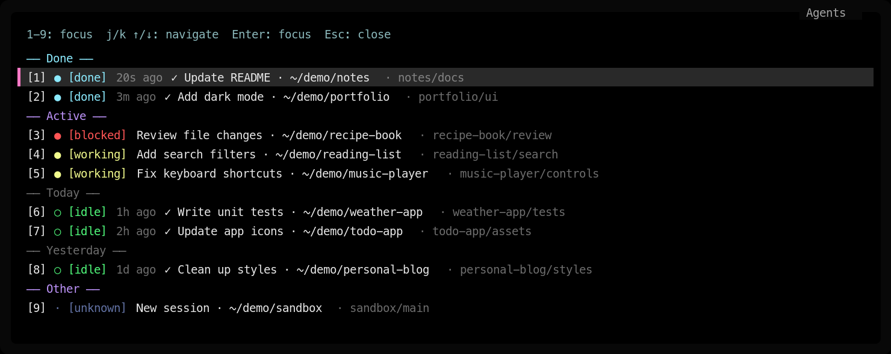

# Herdr Agent Picker

**Preview · 0.1.0-preview.7** — development and implementation live on `preview`.
The default branch is `main`.

A compact, keyboard-driven agent popup for Herdr.



*Illustrative preview using fictional tasks, projects and paths.*

- Colored status first, bold task title, dim workspace/tab location.
- `j`/`k` or arrow keys to navigate; `Ctrl+D`/`Ctrl+U` to move five agents at a time.
  Enter to focus; Esc to close.
- Press `1`–`9` to focus a numbered item immediately, without Enter.
- Current Done and Active agents come first, followed by idle completion history by date.
- Completion ages such as `3m ago`; model metadata is hidden.
- Refreshes the list and status every second while the popup is open.
- Per-agent reminders with time presets, custom dates and cancellation.

## Requirements

- Herdr 0.9.1 or newer.
- Python 3.11 or newer.
- fzf 0.73.1 or newer, available on PATH.
- macOS or Linux. Tested on macOS; Windows is not supported.

On macOS with Homebrew:

```sh
brew install python@3.14 fzf
```

The launcher discovers versioned Python executables on PATH before falling back
to `python3`. Set `HERDR_AGENT_PICKER_PYTHON` to override the interpreter.

## Install the preview

Install dependencies, then install directly through Herdr:

```sh
herdr plugin install kungbi/herdr-agent-picker --ref preview
```

For a fixed version, use `--ref v0.1.0-preview.7`. Run the same command again to
update the installed preview. Configure the keybinding below after installing.

Versioned `.tar.gz` and `.zip` packages with `SHA256SUMS` are available from
[GitHub Releases](https://github.com/kungbi/herdr-agent-picker/releases).
Extract a package to a permanent directory and follow Local installation.

## Local installation

Keep this directory in a permanent location. Run:

```sh
sh ./run check
herdr plugin link "$PWD" --enabled
```

Add this to your Herdr `config.toml`, replacing any existing `prefix+g` command:

```toml
[keys]
goto = ""
next_agent = ""

[[keys.command]]
key = "prefix+g"
type = "plugin_action"
command = "agent-picker.open"
description = "Select agent"
```

Merge the entries into any existing `[keys]` section instead of duplicating it.
Then run `herdr server reload-config`. Use your prefix followed by `g`.

No Python packages or compilation step are required. The same source package
runs on macOS and Linux with the dependencies listed above.

## Reminders

Select an agent and press `a` to schedule a reminder to revisit it, regardless of
whether its work has finished. A small centered dialog opens over the agent list;
Esc returns to the same selection. Custom input and the `r` reminder manager also
use compact dialogs. Choose 5, 10, 15 or 30 minutes, 1 or 2 hours,
tomorrow at 09:00, or **Custom time**.

Custom time has separate **Date** (year, month, day) and **Time** (hour, minute)
fields, prefilled to 30 minutes from now or the agent's existing reservation.

- `Tab` or `←`/`→`: select a field; brackets mark the active field.
- `↑`/`↓` or `k`/`j`: increase or decrease its value.
- Type digits to replace the selected field.
- `Enter`: save; `Esc`: cancel.

Dates and clock times use your computer's local timezone. Invalid dates and past
times show an error without changing the reservation.

Scheduled reminders appear beside their agent as `[alarm MM-DD HH:MM]`.

There is one reminder per agent: setting another replaces it. Press `a` again
and choose **Cancel current alarm**, or press `r` to list scheduled alarms and
select one to cancel. Escape leaves a menu without changing the reservation or
focus; Escape also closes the custom date/time form.

Reminders persist locally and run after the picker closes. At the due time,
Herdr displays a notification with its completion sound. A desktop notification
is also requested on macOS and on Linux when `notify-send` is installed. Allow
notifications in your desktop settings; the OS may suppress them in Focus mode.
The reminder never sends input to an agent or changes the focused pane.

An overdue reminder is delivered after the computer wakes. After a reboot, open
the picker to resume saved reminders. Failed deliveries are retried every minute.
Reminder data stays in `HERDR_PLUGIN_STATE_DIR/reminders.sqlite3` (or the direct
script state directory below); it is excluded from Git and release archives.

## Completion times and ordering

Herdr event hooks record when completion is observed. Tasks completed before the
plugin was enabled have no known completion time. This is not an archived task
history: the picker lists current agents and their latest observed completion.

Current Done agents come first, followed by Active. Within Active, when
`ui.agent_panel_sort = "priority"`, blocked agents precede working agents.
Done includes Herdr's `done` agents and observed working/blocked-to-idle finishes
that have not been visited since completion. Herdr can report a finish in its
last-focused pane as `idle` while the user is elsewhere. These finishes stay in
Done until focus returns to the pane, including selection in the picker, or new
work starts. Previously acknowledged idle agents remain in date history.
Done is sorted by latest known completion time; agents with no known completion
time follow in the same group.
Idle agents with a recorded completion appear below Active, grouped by local
calendar date and sorted newest first within each date. Idle agents with no
recorded completion and agents with unknown status appear in Other at the end.
The list, statuses, numbers and relative ages refresh every second while the popup
is open. The cursor follows the same agent when the list reorders. Refreshing
stops when the popup closes; temporary API failures preserve the previous list.
Snapshots are fetched in the background so navigation and selection remain
available while Herdr responds. The visible list is replaced only when it changes.

The first nine agents are numbered `1`–`9` in displayed order across date sections;
headings have no number. Press a number to focus immediately. Later agents have no
number; use `j`/`k` or arrow keys and Enter to select them. `0` has no shortcut.

Times persist after a completed agent becomes idle and clear when new work starts.
State is stored under `HERDR_PLUGIN_STATE_DIR/completions`, outside this package.
Direct script runs use `$XDG_STATE_HOME/herdr-agent-picker` (default `~/.local/state`).
Server instances are isolated; completion times from before a server restart are
not reused. The earlier standalone picker's records are read as a migration fallback.

Status colors use the Dracula palette. Model stripping only removes recognized
model metadata separated by ` · `, preserving model names mentioned in task text.

## Validation

```sh
sh ./run check
sh ./run test
sh ./run package
```

Tests use fake Herdr responses and real fzf in a pseudo-terminal. They do not
change focus in your live Herdr session or send real notifications.

Packaging creates reproducible `.tar.gz` and `.zip` archives plus `SHA256SUMS`
in `dist/`, using an explicit file list. Local settings, sockets, completion
records and caches are excluded. CI tests Python 3.11 and 3.14 on macOS and Linux.
Pushing a matching `v*-preview.*` tag publishes a GitHub prerelease after tests
pass; the manifest version must match the tag. See [CHANGELOG.md](CHANGELOG.md).

## Removal

```sh
herdr plugin unlink agent-picker
```

Remove the matching keybinding and reload Herdr config. Unlinking preserves state.

## License

MIT. See LICENSE.
